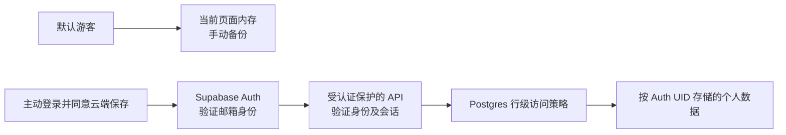

# 第二阶段：登录＋游客后端方案（尚未实现）

整理日期：2026-10-24。第一阶段已按内存游客模式实现；本文件是第二阶段的建议与待办，不代表已接入认证、数据库或跨设备同步。没有真实项目配置、服务端部署或两个真实认证身份，不能把 A/B 隔离、云端保存失败或登录过期验收写成通过。

## 建议采用的架构

保留当前 GitHub Pages 前端、Bento UI、SPA 和计算模块；增加 **Supabase Auth（同页邮箱验证码）＋Postgres RLS＋少量 Edge Functions**。不自建密码系统，不启用游客匿名云登录。游客完全不调用云数据服务。

当前 schema 是资料＋按日期的体重／打卡／感受，适合关系数据库。Supabase 让所有权与操作限制可在 SQL/RLS 中审查，较容易为作品集展示真实的权限边界。Firebase Auth＋Firestore Security Rules 也可行，但需要另做文档结构、读写计费控制和删除函数；不建议为了登录整体重写当前前端。

优先选择在本页输入邮件验证码，避免 OAuth 整页跳转让当前游客内存丢失。参见 [官方邮箱 OTP 配置](https://supabase.com/docs/guides/auth/auth-email-passwordless)。账号 SDK 建议只在用户主动登录时加载，固定版本并本地打包。验证码和身份验证交给成熟服务。**不保存网页自制密码、密码哈希或用户名到密码映射。**

## 数据与访问限制

| 表 | 主要键与字段 | 限制 |
| --- | --- | --- |
| user_profiles | user_id 主键；现有基础资料、习惯、健康选择 | 一人一行，白名单字段与数值校验 |
| weight_entries | user_id＋date 联合主键；weight | 同一账户同日覆盖；保留当前有效范围 |
| habit_entries | user_id＋date；meal、movement | 不引入健康评分 |
| feeling_entries | user_id＋date；fatigue、hunger、completion | 保留原有建议适用规则 |
| data_consents | user_id、说明版本、确认时间 | 只记录保存同意，不记录健康行为追踪 |
| app_sessions | Auth UID＋验证后的 session_id；撤销、过期状态 | 服务端维护，客户端不能创建／篡改授权状态 |

四类业务数据的 user_id 关联 `auth.users.id`，并考虑账户删除的级联关系。不得用邮箱文本、昵称、URL 参数或 localStorage 中的用户名作为授权依据。API 不信任请求体中的所有者字段，使用服务端验证过的身份；即使绕过页面直接请求数据库，RLS 仍必须限制访问。

API 必须验证服务提供商签发的身份令牌（签名、发行方、目标项目和有效期），不能只解码 JWT 或相信前端传入的 UID。

每张业务表默认开启 RLS，撤销 anon 的所有访问授权，只为 authenticated 授予所需操作，并分别配置：

| 操作 | 数据库必须执行的条件 |
| --- | --- |
| SELECT | 当前已验证 Auth UID 等于该行 user_id，且会话有效 |
| INSERT | 新行 user_id 等于当前 Auth UID，且会话有效 |
| UPDATE | 旧行属于当前 UID，新行仍属于当前 UID，会话有效；同时设置 USING 和 WITH CHECK |
| DELETE | 该行属于当前 UID，且会话有效 |

这张表是策略设计，**还不是已部署的 SQL**。实施时应为四张表分别编写迁移和真实角色测试。普通业务 API 必须使用用户 JWT 调用数据库，让 RLS 生效；不能用管理员密钥读出全库再由前端过滤。[Supabase RLS 官方说明](https://supabase.com/docs/guides/database/postgres/row-level-security)

服务端也需做字段、日期、体重范围、枚举、数据量与请求大小校验；抽取并复用当前纯校验逻辑，避免只信任浏览器。计算与健康适用限制继续沿用现有规则。采用版本号／乐观锁处理跨设备冲突；保存失败不显示成功、不覆盖较新记录、不把失败队列留给下一账号自动重试。

## 退出、账号切换与过期

建议账户健康数据和认证令牌也只留在页面内存（SDK `persistSession:false`），刷新后重新认证再加载账户数据；云端仍保留已确认保存的数据，因此能够跨设备访问。若将来需要“记住登录”，必须单独设计共享设备风险与会话策略，不在本轮默认增加。

前端至少维护认证状态、当前 UID 和单调递增的会话代次：

1. 退出、切换账号、401／会话失效、页面缓存恢复时，先递增代次，取消请求与订阅，清空健康 state、DOM、草稿、预览、待保存队列和 SDK 令牌，再回首页。
2. 每个请求发出时捕获 UID 和代次；发出前、收到响应后、渲染前均检查仍匹配。旧账号响应即使稍后成功也必须丢弃。数据对象保留其所有者标签，不能在换成 B 的令牌后继续提交 A 的旧请求体。
3. 请求使用 `cache:no-store`，服务端健康数据响应使用 `Cache-Control:no-store`；不建立健康数据 Service Worker／IndexedDB 离线缓存。页面生命周期继续沿用第一阶段的遮蔽与清理。
4. 云端保存失败显示“未保存”，只在仍有效的同一账号会话内保留可重试草稿；过期后立即清理页面，不把旧账号数据降级成新游客资料。
5. 登录过期的清理不能只等下一次请求：根据可信会话到期时间安排清屏，监听认证变化、刷新失败、401，以及回到页面时的有效性检查；服务端期限始终独立强制执行。
6. 退出时即使断网也立即清理本地；若服务端撤销尚未确认，明确说明，不能伪报已在所有设备退出。AbortController 不能撤回已经在服务器完成的写入。

**仅调用 signOut 或检查 JWT 签名不足以承诺立即撤销。** 已签发访问 JWT 可能在过期前仍有效。因此建议受保护的 API 与 RLS 同时检查服务端 app_sessions 的有效状态／期限，所有 CRUD 路径统一执行，不能只保护删除接口。会话记录只能根据验证后的 Supabase 身份和 session_id 创建或撤销；建立记录时还须确认对应 Auth 会话确实有效。保留被撤销 session_id 的撤销标记，禁止仅凭未过期的旧 JWT 重新激活会话。RLS 的会话检查应是受限服务端函数，不向客户端开放 Auth 会话表。即时撤销、并发写入边界、超时设置必须在真实后端联调，而非靠客户端定时器假装完成。[Supabase 会话说明](https://supabase.com/docs/guides/auth/sessions) · [退出说明](https://supabase.com/docs/guides/auth/signout)

## 游客登录后的保存同意

登录前的游客数据仅在当前页面 RAM 中。登录成功后，显示保存说明和选择：本次资料包含哪些字段、将保存到哪个已验证账户、用途为计划生成／趋势回顾／跨设备访问，是否保存本次游客数据。

- 默认不上传、不合并。拒绝后不写账户；允许先导出游客备份，再明确选择丢弃游客副本并进入账户。
- 同意后先校验本次内存快照。如果账户已有资料／同日记录，先说明影响并让用户明确选择导入策略；没有再次确认就不覆盖或合并旧记录。
- 旧版 localStorage 不属于登录用户。它不自动进入游客快照或账号；必须先经过第一阶段的手动确认恢复，再经过这次云端保存确认。
- 不把健康内容放在 URL、认证回调参数、日志、分析事件或错误上报中，不接健康分析／追踪 SDK。
- 同页 OTP 可保留游客内存；若刷新、页面冻结或整页 OAuth 跳转导致内存清空，不通过偷偷落盘来绕过游客策略。用户可预先手动导出备份。

## 删除个人数据

登录后应提供真实工作的“删除我的云端数据”入口；在没有后端之前不放假按钮。该操作要求重新验证身份并明确确认。

服务端删除端点从已验证令牌确定用户，不能接收任意 user_id 让客户端指定别人。删除该 UID 的业务数据、同意记录和会话；如用户选择注销账户，再使用仅在服务端保存的管理密钥删除 Auth 用户。跨数据库／Auth 服务步骤需要可重试的状态记录，全部成功前不能声称完全删除。

删除后清空页面及令牌、取消在途请求和旧订阅，过期响应不得重建数据。对已有备份与供应商保留周期明确说明，不承诺在线删除会立刻抹掉供应商历史备份；备份文件由用户自己保管或删除。

## 费用与限制

以下美元价格于 2026-10-24 查阅官方页面，未包含税费、域名、外部发信、额外计算和超额用量；不是固定总价承诺。

| 方案 | 基础费用 | 与本项目有关的额度／限制 |
| --- | --- | --- |
| 现在的内存游客模式 | 无后端费用 | 不提供账户或跨设备自动恢复；备份靠手动导出 |
| Supabase Free（建议先联调） | $0／月 | 500 MB 数据库、50,000 月活认证用户、5 GB 出站流量；最多两个活跃免费项目，闲置一周可能暂停 |
| Supabase Pro（公开账户功能再评估） | 从 $25／月 | 一个基础项目计算额度、8 GB 磁盘、100,000 月活；额外项目／资源／超额可能另计；不是无限使用 |
| Firebase 备选 | Spark 免费额度，Blaze 按量 | Firestore 免费额度含 1 GiB、每日 50,000 读／20,000 写／20,000 删；认证额度因登录方式和 Identity Platform 配置不同，函数和超额费用需另算 |

[Supabase 官方价格](https://supabase.com/pricing) · [Firestore 官方额度](https://firebase.google.com/docs/firestore/quotas) · [Firebase 计费方案](https://firebase.google.com/docs/projects/billing/firebase-pricing-plans)

使用 Supabase 邮箱验证码时，公开服务需要自有 SMTP 发信配置。默认发信只适合团队预授权邮箱测试，当前限制为每小时两封，不能据此承诺公众注册可用。自有发信域名及服务可能产生额外费用。[SMTP 官方限制](https://supabase.com/docs/guides/auth/auth-smtp)

免费项目暂停或额度耗尽时，账户功能必须报告不可用，游客体验继续留在本页；不能假装云端已保存。地区网络可达性、实际费用和发信投递率需要在目标使用地区实测。上线前设预算提醒，检查供应商计费控制；不要把提醒当成所有资源的绝对费用上限。

## 你需要操作的步骤

1. 创建自己的 Supabase 组织和**测试项目**，开启管理账号 MFA，选择数据区域与 Free／Pro；真实健康数据先不要导入测试环境。
2. 决定是否采用同页邮箱验证码，准备可用发信域名和 SMTP，私密凭据只填供应商后台。将邮件模板配置为可在本页输入的验证码，不能仅沿用会跳转整页的登录链接；验证码校验仍由 Supabase SDK／服务完成。设置正式 Site URL 和精确允许的回调地址（包含 `/qingying-plan/`），不要用任意通配地址。
3. 在真正接入时，仅提供项目 URL 和可公开的 publishable key。数据库密码、secret/service_role key、SMTP 密码只存服务端环境密钥管理；不放到前端、GitHub 或聊天中。
4. 在测试项目应用经过审查的建表、授权、RLS、会话有效性检查和删除函数；关闭匿名云登录，确认 anon 无数据访问权。普通 CRUD 用用户 JWT，不使用管理员身份绕过策略。
5. 创建两个不同的真实测试认证身份 A/B，由服务提供商完成验证；准备一个没有令牌的游客请求。完成下表所有服务端检查后，才能宣布账户隔离已完成。
6. 接入前端状态机、明确云端保存说明、游客迁移选择、真实删除入口及错误提示；验证切换／退出／过期／慢请求。不要把数据库数据缓存到浏览器持久存储。
7. 在测试环境验收、确认费用与邮件可达性，再另行授权部署前端和函数。当前分支只包含第一阶段及本方案，不会自动修改生产服务或 Pages。

## 尚待真实后端验收（本轮均未验证）

| 场景 | 必须观察的结果 |
| --- | --- |
| A 直接查询 B 的资料／日期记录 | 没有 B 的数据；使用 B 自己的身份可正常读取同一记录，排除测试请求本身无效 |
| A 新增 user_id=B；A 把自己的所有者改为 B | 数据库策略拒绝，不能只依赖页面不提供按钮 |
| A 修改／删除 B 的记录 | 可能是拒绝或零行匹配；再用 B 读取并确认值未变，不能只看 HTTP 200 就算成功 |
| 无令牌／过期令牌／伪造身份 | 服务端拒绝，页面无上一账号残留，不能自动重试到另一个账号 |
| A 请求未完成时退出、切换 B、浏览器返回或缓存恢复 | A 响应和队列不能渲染或提交进 B；本地状态、预览和令牌被清理 |
| 保存断网、服务端拒绝、超额、版本冲突 | 不显示成功，不覆盖较新数据；是否重试由仍有效的同一身份决定 |
| 退出后使用旧 JWT 请求 API 和直接 REST | 服务端会话撤销规则阻止新访问，不能仅等待前端清空或 JWT 自然到期 |
| 游客登录后拒绝／同意保存，账户已有记录 | 拒绝零写入；同意需要清楚的导入决策，没有旧 localStorage 自动归属 |
| 删除个人数据／注销失败或成功 | 服务端身份确认、只影响自己、如实报告部分失败、清理页面和在途响应 |

第一阶段可实际验证的是游客页面隔离与清理、旧数据的明确选择、手动备份及失败处理。它没有认证账号，因此“两个游客页面互不共享”不能冒充“A 账号无法访问 B 账号”的服务端验证。
